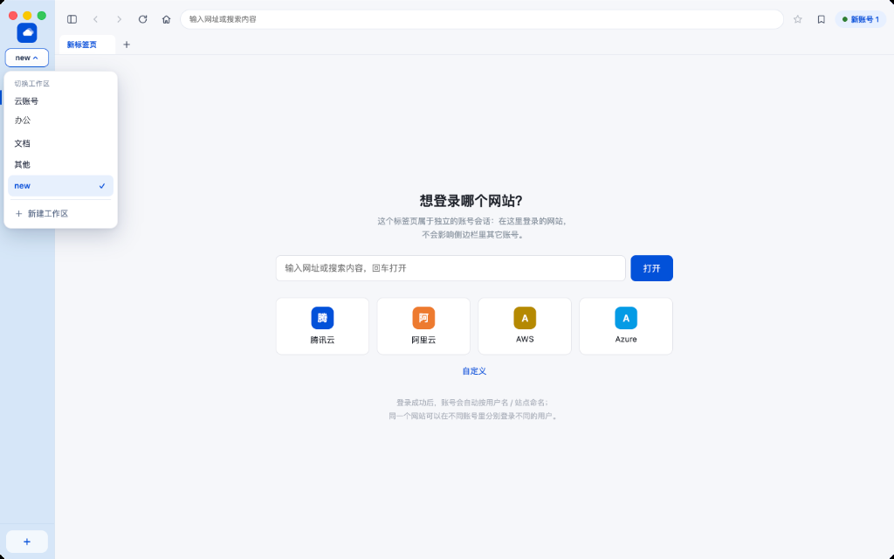

# WorkPier

> **Stay signed in to several accounts at once.** WorkPier is a desktop browser for people who keep more than one login for the same site — cloud consoles, docs, mail, or anything else. Each account lives in the sidebar. Click it, and you are there. The page does not reload, and you do not log out of the others.
>
> **同一个网站，多个账号一起在线。** WorkPier 把每个账号放在侧边栏里。点一下就切过去，当前页面不用重新加载，其它账号也不用退出。


**English** · [简体中文](README.zh-CN.md)

<p align="center">
  
</p>

<p align="center">
  <a href="https://github.com/SirKayZh/workpier/releases"></a>
  &nbsp;
  <a href="https://github.com/SirKayZh/workpier/issues/new"></a>
</p>

---

<p align="center">
  
</p>

<p align="center">
  <em>Several accounts stay in the sidebar. The page you are reading does not reload when you switch.</em>
</p>

<p align="center">
  &nbsp;
  
</p>

<p align="center">
  <em>A new tab asks which site to sign in to (left). The shortcut sites can be renamed, reordered, or removed (right).</em>
</p>

---

## Why WorkPier?

Opening a second Chrome profile, or a second browser, means another window and another place to look. WorkPier keeps those logins in one window. The account you are not looking at stays signed in.

| | **WorkPier** | **Chrome profiles** | **Several browsers** |
|---|:---:|:---:|:---:|
| **Price** | Free, open source | Free | Free |
| **Several logins, one window** | Yes | A profile is its own window | One app per login |
| **Switch without reloading** | Sidebar click | Switching profile reloads the window | Switch apps |
| **Tabs per account** | Yes | Yes | Yes |
| **Two windows on the same login** | Yes | Yes | Yes |
| **Passwords stay with that account** | Yes | Per profile | Per browser |
| **Stays on this computer** | Yes | Sync is optional | Yes |
| **macOS and Windows** | Yes | Yes | Yes |

---

## Features

### Several accounts, side by side

- Add an account with no form to fill. A new tab opens. Type an address, or pick a site you use often.
- Sign in on the page the way you always do. WorkPier names the account from the login when it can. Rename it any time.
- The same site can be signed in under different accounts. They do not overwrite each other.
- `⌘1`–`⌘9` jumps to an account in the current workspace. On Windows, use the sidebar.

### Tabs, windows, and the page you left

- Each account has its own tabs. `⌘T` opens one, `⌘W` closes one. Drag a tab to reorder it.
- A new window (`⌘N`, or the Dock menu on macOS) opens the page you are already looking at, still on that account, so you can compare two pages.
- Closing one window leaves the others open. Tabs you opened only in a later window are not restored. The main window’s tabs come back next launch.
- Star a page to bookmark it. The new-tab page can hold the sites you open every day.
- Find on the page with `⌘F`.

### Still signed in next time

- Quit and open WorkPier again. You land on the same accounts and tabs.
- Session cookies that a site would normally throw away on quit are kept, up to the 400 days a browser allows. Each launch, and every 12 hours while it is open, pushes that date forward again.
- If the website itself expires the login, you sign in again. WorkPier cannot extend a login the server has already rejected.
- Upgrading from the old name CloudDock moves your existing accounts and saved passwords across on the first launch.

### Passwords, kept apart

- After a successful sign-in, WorkPier asks whether to save the password.
- Next time that login page opens, it fills the saved username and password.
- Account B cannot see passwords saved under account A. Deleting an account deletes its saved passwords too.

### Workspaces

- The sidebar can be split into workspaces, so cloud accounts and docs do not sit in one long list.
- Collapse the sidebar to avatars. `⌘B` toggles it. The choice is remembered.

---

## Install

Download the latest build from [Releases](https://github.com/SirKayZh/workpier/releases).

**macOS (Apple Silicon)**

- Open `WorkPier-<version>.dmg` and drag WorkPier into Applications.
- The app is not notarized. If macOS says the developer cannot be verified, right-click the app and choose **Open**, or run:

```bash
xattr -cr /Applications/WorkPier.app
```

**Windows**

- Download `WorkPier-<version>-win-x64.zip`, unzip it anywhere, and run `WorkPier\WorkPier.exe`. No installer and no admin rights.
- If SmartScreen appears, choose **More info**, then **Run anyway**.

People already on an older build get an update prompt about five seconds after launch, or from **Help → Check for Updates**.

What changed in each release: [CHANGELOG.md](CHANGELOG.md). The same text is on the [Releases](https://github.com/SirKayZh/workpier/releases) page.

---

## Keyboard shortcuts

Menu shortcuts use `⌘` on macOS and `Ctrl` on Windows.

| Action | macOS | Windows |
| --- | --- | --- |
| Switch account | ⌘1 – ⌘9 | Sidebar |
| New tab | ⌘T | Ctrl+T |
| Close tab | ⌘W | Ctrl+W |
| New window | ⌘N | Ctrl+N |
| Previous / next tab | ⌘⇧[ / ⌘⇧] | Ctrl+Shift+[ / ] |
| Back / forward | ⌘[ / ⌘] | Ctrl+[ / ] |
| Bookmark this page | ⌘D | Ctrl+D |
| Find on page | ⌘F | Ctrl+F |
| Find next / previous | ⌘G / ⌘⇧G | Ctrl+G / Ctrl+Shift+G |
| Reload | ⌘R | Ctrl+R |
| Collapse sidebar | ⌘B | Ctrl+B |
| Zoom in / out / reset | ⌘= / ⌘- / ⌘0 | Ctrl+= / Ctrl+- / Ctrl+0 |
| Developer tools | ⌘⌥I | Ctrl+Alt+I |

---

## Privacy

WorkPier is local. Pages you open are between you and that website. WorkPier does not add analytics, and it does not upload crash reports.

- Saved passwords are encrypted on disk. On macOS the key lives in the login keychain. On Windows the key is protected for the current Windows user. The page itself cannot read the saved password back out of WorkPier.
- Account data stays in `~/Library/Application Support/WorkPier` on macOS, and in `%APPDATA%\WorkPier` on Windows.
- To start over, quit WorkPier and delete that folder.

---

## Feedback

- [Report a bug or request a feature](https://github.com/SirKayZh/workpier/issues/new)

---

## Development

```bash
git clone https://github.com/SirKayZh/workpier.git
cd workpier
npm install          # Node >= 22.12
npm run typecheck
npm test
npm start
```

Use a throwaway data directory when you do not want to touch your real accounts:

```bash
WORKPIER_DATA_DIR=/tmp/workpier-dev npm start
```

```bash
npm run package            # macOS arm64 → release/WorkPier.app, dmg, update zip
./scripts/package-win.sh   # Windows x64 portable zip, merged into update.json
```

The packaged app checks `https://github.com/SirKayZh/workpier/releases/latest/download/update.json`. A release has to include both the macOS zip and the Windows zip, or Windows installs will see an update they cannot apply.

---

## License

[MIT](LICENSE) © 2026 SirKayZh
